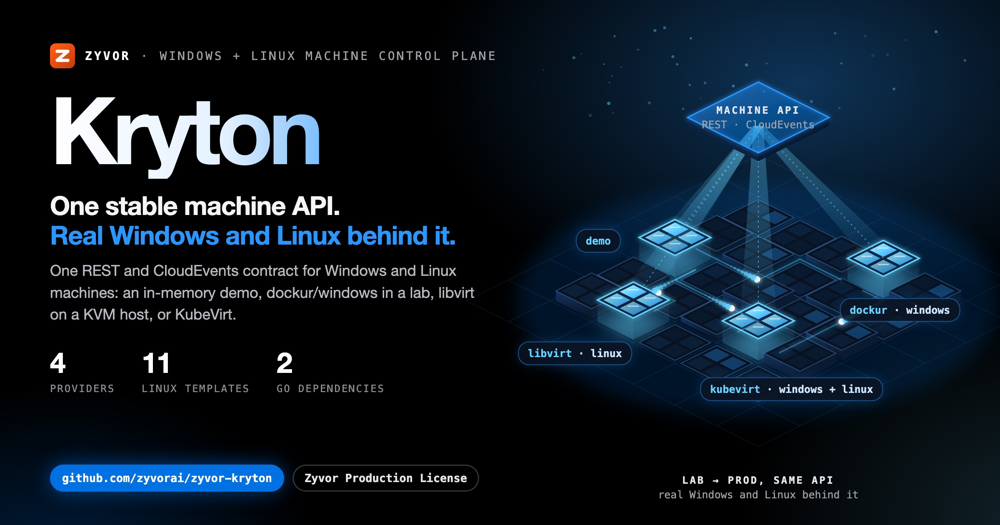
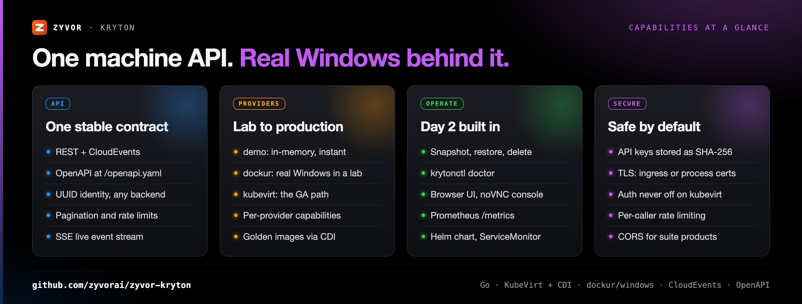
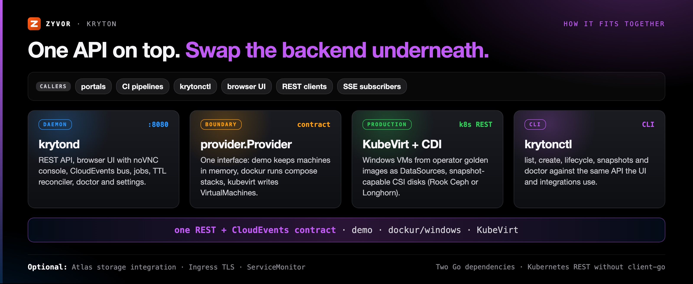

<div align="center">

# Kryton

[](https://github.com/zyvorai/zyvor-kryton/actions/workflows/ci.yml)
[](LICENSE)
[](https://go.dev/)
[](https://pkg.go.dev/github.com/zyvorai/kryton)

[](https://zyvor.dev/schedule?utm_source=github&utm_medium=kryton&utm_campaign=readme_hero)
[](https://zyvor.dev/poc?utm_source=github&utm_medium=kryton&utm_campaign=readme_hero)
[](#quickstart)



### One stable machine API. Real Windows and Linux behind it.

**A control plane for Windows and Linux machines.** Portals, CI and automation talk to one REST + CloudEvents contract whether the backend is an in-memory **demo**, real Windows via **[dockur/windows](https://github.com/dockur/windows)** on a lab host, Linux cloud images on a KVM host via **libvirt**, or Windows and Linux VMs on **KubeVirt**.

**4 providers, 1 contract** · **11 Linux templates** · **REST + CloudEvents + OpenAPI** · **Snapshots on CSI** · **Hashed API keys** · **2 direct Go dependencies**

📖 **[User guide](docs/USER-GUIDE.md)** · **[Product docs](https://zyvor.dev/docs/kryton?utm_source=github&utm_medium=kryton&utm_campaign=readme_hero)** · **[API](docs/API.md)** · **[GA checklist](docs/GA.md)**

</div>

---

## What's new

From [CHANGELOG.md](CHANGELOG.md) (1.1.0 to 1.4.4):

| | |
|---|---|
| **Operations and observability** | Prometheus `/metrics` (machines by state, provider health, latency histograms, quotas) behind a metrics token; append-only audit log with `GET /api/v1/audit`; HMAC-signed per-project webhooks with retries, dead letters and an SSRF guard; cron-scheduled start/stop/restart/snapshot with timezones; machine TTL extend/default; per-project quotas; per-project API-key roles. See [docs/OBSERVABILITY.md](docs/OBSERVABILITY.md). |
| **Unattended Windows workflows** | dockur machines can mount a host-managed shared folder and an OEM script, run guest **jobs** (`krytonctl job-run --wait`), expose a real **readiness probe** (`/machines/{id}/ready`: container, RDP handshake, agent heartbeat), restart gracefully, and report install progress. Passwords are generated when omitted, and RDP and the console bind to loopback unless you opt in with `publicBind`. |
| **API rate limiting** | `KRYTON_RATE_LIMIT_RPS` / `KRYTON_RATE_LIMIT_BURST`: a per-caller token bucket keyed by API-key name, returning `429` / `RATE_LIMITED`. Off by default. |
| **Fleet operations** | Label selectors on `GET /machines?selector=`, `Idempotency-Key` on create, bulk start/stop/snapshot/delete by id or selector with `dryRun` and a delete `confirm` guard (`POST /machines/actions`, up to 100 machines, per-machine results), `allowedActions` on machines, `state`/`name` list filters, `summary?groupBy=` and event filters (`type`, `machineId`, `since`) on both the list and the SSE stream. See [docs/API.md](docs/API.md#fleet-operations); research and ranked ideas in [docs/RESEARCH.md](docs/RESEARCH.md). |
| **Guard rails** | Delete protection (blocks delete, bulk delete and TTL expiry), snapshot retention and run-now for schedules, auto-disable after repeated failures, and a project-wide snapshot inventory. The web console covers these plus bulk actions with a dry-run preview. See [docs/API.md](docs/API.md#fleet-operations). |
| **Pagination** | `GET /api/v1/machines?limit=&cursor=` with `nextCursor`, matching the events API. |
| **Helm for operations** | `serviceMonitor` and `podDisruptionBudget` templates, plus a chart README for every values key and overlay. |
| **KubeVirt production scripts** | `scripts/setup-kubevirt-production.sh` automates golden-image build and CDI bootstrap end to end. |
| **Lab auto-auth** | `KRYTON_LAB_AUTO_AUTH` so shared lab hosts don't need a bearer token pasted per session. |
| **Full dockur options** | `spec.dockur` on create: credentials, locale, AD join, shared folders, custom ISO, secure boot + TPM, extra disks and more. |
| **Console and catalog** | Embedded noVNC console with no CDN dependency, Copy RDP, and 12 dockur catalog images. |

---

## Why Kryton

| When this happens… | Kryton gives you… |
|---|---|
| Every portal, pipeline and script talks to Windows and Linux VMs differently | **One REST + CloudEvents contract** with OpenAPI at `/openapi.yaml`, whatever the backend |
| You want to prototype on a laptop and ship on Kubernetes | **Same API, four providers**: `demo` → `dockur` / `libvirt` → `kubevirt` |
| You need Linux VMs next to Windows ones | **Eleven Linux cloud-image templates** (Ubuntu, Debian, Rocky, AlmaLinux, CentOS Stream, Fedora) with cloud-init, SSH keys and checksum-pinned images |
| Integrations break when a VM moves namespace or gets renamed | **Stable UUID identity**, independent of the provider's own name |
| Raw KubeVirt gives your apps YAML, not an API | **Machines, lifecycle, snapshots, jobs and an SSE event stream** over HTTP |
| Shared credentials for automation make auditors nervous | **API keys stored as SHA-256 digests**, TLS, per-caller rate limits, auth never disabled on `kubevirt` |
| "Is this host ready?" is a half-day of guessing | **`krytonctl doctor`**: auth, catalog, namespaces, DataSources, snapshot CRDs, StorageClass ↔ snapshot class |



---

## How it fits together



Kryton is deliberately split at the **provider boundary**. Callers see one stable machine API; providers translate it into demo state, dockur compose stacks, libvirt domains, or KubeVirt VirtualMachines. Details: [docs/ARCHITECTURE.md](docs/ARCHITECTURE.md).

```text
  Veyron / Zeus / Atlas / Haven / Axiom / CI
                    │
             REST + CloudEvents
                    │
                 Kryton
    demo │ dockur │ libvirt │ kubevirt
```

### How to use Kryton

Full walkthroughs: **[docs/USER-GUIDE.md](docs/USER-GUIDE.md)**.

| You are… | Do this | Provider | Auth |
|----------|---------|----------|------|
| Trying locally | `make demo` → `:8080` | `demo` | off |
| Real Windows in a lab | [Remote deploy](#remote-deploy) + [dockur](#dockur-lab-provider) | `dockur` | apikey |
| Linux VMs on a KVM host | [Linux on libvirt](#linux-vms-libvirt-and-kubevirt) | `libvirt` | apikey |
| Production K8s | [Golden image](docs/GOLDEN-IMAGES.md) + [KubeVirt](#kubevirt-windows-vms) + Helm (Windows and Linux) | `kubevirt` | apikey + TLS |
| Portal / CI | [API](#api) + `KRYTON_TOKEN` | any | apikey |

---

## Quickstart

Requires **Go 1.27.1+**.

```bash
git clone https://github.com/zyvorai/zyvor-kryton.git && cd zyvor-kryton
make demo
```

Open [http://localhost:8080](http://localhost:8080). Local demo uses `demo` provider with auth **disabled** — evaluation only.

```bash
go run ./cmd/krytonctl list
go run ./cmd/krytonctl create win-dev-01
go run ./cmd/krytonctl doctor
```

New here? [`docs/FAQ.md`](docs/FAQ.md) · troubleshooting in [USER-GUIDE](docs/USER-GUIDE.md#troubleshooting), [AUTH](docs/AUTH.md#troubleshooting), [KUBEVIRT](docs/KUBEVIRT.md#troubleshooting)

## Install

```bash
make build
sudo install -m755 bin/krytond bin/krytonctl /usr/local/bin/
```

Container: `docker build -t kryton:dev .` with `KRYTON_PROVIDER=demo`, `KRYTON_AUTH_MODE=disabled`, `KRYTON_ALLOW_INSECURE=true`.

| Target | What it does |
|--------|----------------|
| `make check` | fmt · test · vet · build |
| `make deploy-remote H=… U=…` | SSH deploy — [DEPLOY-REMOTE.md](docs/DEPLOY-REMOTE.md) |
| `make setup-kubevirt-production BUILD=1` | Golden + CDI + API + VM |

## KubeVirt Windows VMs

```bash
VERSION=11e ./scripts/build-golden-image.sh
export KRYTON_WINDOWS_IMAGE=./out/windows-11e-golden.qcow2
./scripts/setup-kubevirt.sh
```

See **[docs/KUBEVIRT.md](docs/KUBEVIRT.md)** and **[docs/GOLDEN-IMAGES.md](docs/GOLDEN-IMAGES.md)**.

## Linux VMs (libvirt and KubeVirt)

Eleven amd64 cloud-image templates: **Ubuntu 22.04 / 24.04 / 26.04, Debian 12 / 13, Rocky 9 / 10, AlmaLinux 9 / 10, CentOS Stream 10, Fedora 44**. Guests get cloud-init with your SSH keys and user; the UI shows the guest IP and a ready-to-copy `ssh` command (browser console on KubeVirt; not yet on libvirt). `kryton-image` fetches images against an approved SHA-256 and exports them to libvirt or CDI.

```bash
# Native libvirt host: deploy, fetch an image, create a VM
./scripts/deploy-remote.sh <host> <user> --key --apikey --provider libvirt
bin/kryton-image fetch --image ubuntu-24.04 --dir /var/lib/kryton/images --sha256 "$APPROVED_SHA256"
krytonctl create --image ubuntu-24.04 --cpu 2 --memory 2048 --disk 20 --ssh-key ~/.ssh/id_ed25519.pub linux-dev
```

On KubeVirt, publish the image as a CDI `DataSource` (`kryton-image cdi`) and create the same way. Setup, image verification and host requirements: **[docs/LINUX-TEMPLATES.md](docs/LINUX-TEMPLATES.md)**; host test evidence: [docs/LINUX-TEST-RESULTS.md](docs/LINUX-TEST-RESULTS.md). libvirt is an initial host backend, not GA.

## Remote deploy

```bash
make deploy-remote H=<host> U=<user> ARGS='--quick --key'
make deploy-remote H=<host> U=<user> ARGS='--quick --key --apikey --provider libvirt'   # Linux on libvirt
```

## Dockur lab provider

```bash
export KRYTON_PROVIDER=dockur
export KRYTON_DOCKUR_PUBLIC_HOST=<your-host-ip>
krytonctl create --image windows-11-enterprise --cpu 4 --memory 8192 lab-win01
```

See **[docs/DOCKUR.md](docs/DOCKUR.md)**.

## Helm (KubeVirt)

Production: KubeVirt + CDI, administrator `DataSource` objects, API-key auth. See **[docs/DEPLOYMENT.md](docs/DEPLOYMENT.md)** and `deploy/helm/kryton/README.md`.

**Authentication:** `./scripts/ensure-api-keys.sh` → `~/.kryton/lab.token`. Full guide: **[docs/AUTH.md](docs/AUTH.md)**.

## API

Discovery at `GET /api/v1`; machines at `GET/POST /api/v1/machines`; lifecycle, snapshots, events stream. OpenAPI: [`openapi.yaml`](openapi.yaml) and `/openapi.yaml`. Contract: **[docs/API.md](docs/API.md)**.

Configuration highlights: `KRYTON_PROVIDER`, `KRYTON_AUTH_MODE`, `KRYTON_ADDR`, `KRYTON_KUBECONFIG`, `KRYTON_STORAGE_CLASS`, `KRYTON_CORS_ORIGINS`, rate limits — full table in prior docs or `internal/config`.

## Development

```bash
make check && make test && make race && make vet
```

CI runs license headers, golangci-lint, govulncheck, gosec, tests, multi-arch container image build. **[CONTRIBUTING.md](CONTRIBUTING.md)**.

## What Kryton is not

Not a Windows installer, activation service, or media distributor. Microsoft licensing remains the **operator's** responsibility. Linux images are fetched from the distributions by the operator against an approved checksum; Kryton ships none.

## Docs

| Doc | Topic |
|-----|--------|
| **[USER-GUIDE.md](docs/USER-GUIDE.md)** | All personas — start here |
| [docs/README.md](docs/README.md) | Index |
| [GA.md](docs/GA.md) | Production checklist |
| [ARCHITECTURE.md](docs/ARCHITECTURE.md) | Provider boundary |
| [LINUX-TEMPLATES.md](docs/LINUX-TEMPLATES.md) | Linux images on libvirt and KubeVirt |
| [SECURITY.md](SECURITY.md) | Reporting |

Share cards: `./docs/social/build-hero-dark.sh` and `./docs/social/build-social-card.sh`

---

## Maturity

> **Maturity (honest):** [`docs/GA.md`](docs/GA.md) is the production checklist — **`dockur` remains a lab installer and `libvirt` an initial host backend, neither GA**; multi-replica `krytond` is explicitly out of GA scope (single-writer reconciler, in-process event bus). **KubeVirt is the GA path.**

| Area | Status |
|---|---|
| `kubevirt` provider behind Helm, API keys and TLS | GA path |
| `dockur` provider | Lab installer, not GA (no dockur snapshots) |
| `libvirt` provider (Linux) | Initial host backend, not GA |
| `demo` provider | Evaluation only, in-memory |
| Multiple `krytond` replicas | Out of GA scope (`replicaCount: 1`) |
| Live migration of the guest VM | Out of GA scope |

---

## Part of the Zyvor stack

| Product | Role next to Kryton |
|---|---|
| **Kryton** | Windows and Linux machine control plane: one machine API over demo, dockur, libvirt and KubeVirt |
| **[Atlas](https://github.com/zyvorai/zyvor-atlas)** | Storage control plane; Kryton integrates via Settings → Integrations ([docs/ATLAS.md](docs/ATLAS.md)) |
| **[Haven](https://github.com/zyvorai/zyvor-haven)** | A suite product Kryton's CORS support is designed for, so its browser UI can call Kryton |
| **[Kairon](https://github.com/zyvorai/zyvor-kairon)** | Next to Kryton: VMs on Kubernetes without KubeVirt, including Windows guests |

→ [zyvor.dev](https://zyvor.dev)

---

## Support

A 30-day trial is available on request from sales@zyvor.dev (a paid evaluation Order at no charge); production and any other use needs a paid Order under the Zyvor Production Licence v2.0. If it helps you, you can donate any amount you like: <https://rzp.io/rzp/utwdYh3>. A donation is voluntary and supports development and maintenance. It is not a purchase: it buys no support, SLA, features, priority or license, and it is not tax-deductible (Zyvor AI Labs Private Limited is a company, not a charity). Zyvor Enterprise (supported releases, SLAs, a named contact and enterprise features) is separate: [sales@zyvor.dev](mailto:sales@zyvor.dev).

---

## License

Kryton is source-available under the **[Zyvor Production Licence v2.0](LICENSE)** (SPDX `LicenseRef-Zyvor-Production-2.0`, also in [LICENSES/](LICENSES/LicenseRef-Zyvor-Production-2.0.txt); see [NOTICE](NOTICE)).

- **Trial:** a 30-day trial is available on request from [sales@zyvor.dev](mailto:sales@zyvor.dev) (a paid evaluation Order at no charge).
- **Production and any other use needs a paid Order** under the Zyvor Production Licence v2.0. Buy / get a quote: [zyvor.dev/buy](https://zyvor.dev/buy) · [sales@zyvor.dev](mailto:sales@zyvor.dev).
- **Price:** INR 29,699 per node per year incl. 18% GST in India; US$300 per node per year excl. tax elsewhere. Buy: [zyvor.dev/buy](https://zyvor.dev/buy). Orders of USD 5,000 or more and quotes are invoiced in USD through Skydo.

**Zyvor Enterprise** adds what production teams ask for: supported releases, deployment and upgrade guidance, priority incident triage, a named technical contact and 24x7 critical intake. Plans and terms: [docs/SUBSCRIPTION-MODEL.md](docs/SUBSCRIPTION-MODEL.md) · [Pricing](https://zyvor.dev/pricing?utm_source=github&utm_medium=kryton&utm_campaign=readme_license) · [sales@zyvor.dev](mailto:sales@zyvor.dev). Support is on the one Zyvor Support meter per worker node per year: Supported INR 59,999 in India / USD 600 elsewhere, Supported Plus INR 119,999 in India / USD 1,200 elsewhere. Prices: INR incl. 18% GST in India; US dollars excl. tax elsewhere. Buy / get a quote: [zyvor.dev/buy](https://zyvor.dev/buy).

Report vulnerabilities per [SECURITY.md](SECURITY.md). Contributions: [CONTRIBUTING.md](CONTRIBUTING.md).

---

<div align="center">

### Give your Windows and Linux machines one API

[](https://zyvor.dev/schedule?utm_source=github&utm_medium=kryton&utm_campaign=readme_footer)
[](https://zyvor.dev/poc?utm_source=github&utm_medium=kryton&utm_campaign=readme_footer)
[](https://zyvor.dev/pricing?utm_source=github&utm_medium=kryton&utm_campaign=readme_footer)
[](mailto:sales@zyvor.dev?subject=Kryton)
[](https://github.com/zyvorai/zyvor-kryton)

</div>

## Gateway API (optional, Setura)

As an alternative to the Ingress, the chart can expose the service through a Gateway API
`Gateway` and `HTTPRoute` served by [Setura](https://github.com/zyvorai/zyvor-setura-gateway).
Install the controller once per cluster, then switch the chart over:

```sh
setura gateway install --image ghcr.io/zyvorai/zyvor-setura-gateway:0.7.0 --namespace setura-system | kubectl apply -f -
helm upgrade --install RELEASE CHART_PATH --set gateway.enabled=true --set ingress.enabled=false
```

Hosts and paths come from the `ingress` values. Set `gateway.tls.enabled=true` and
`gateway.tls.secretName` to add an HTTPS listener. `gateway.enabled` defaults to `false`.
